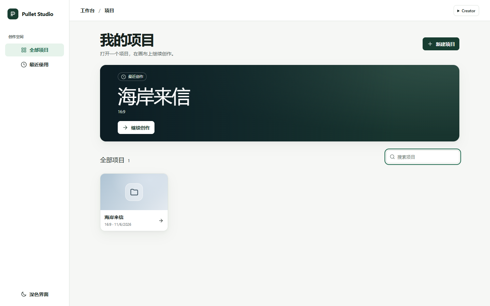
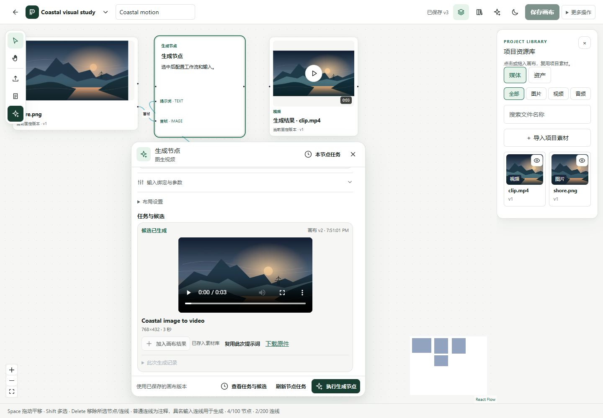
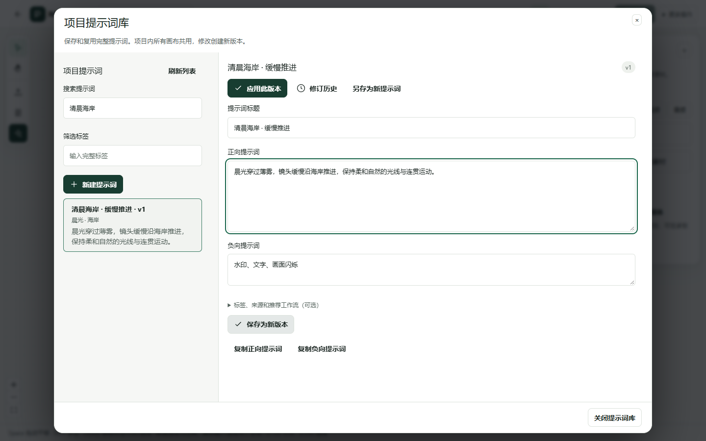
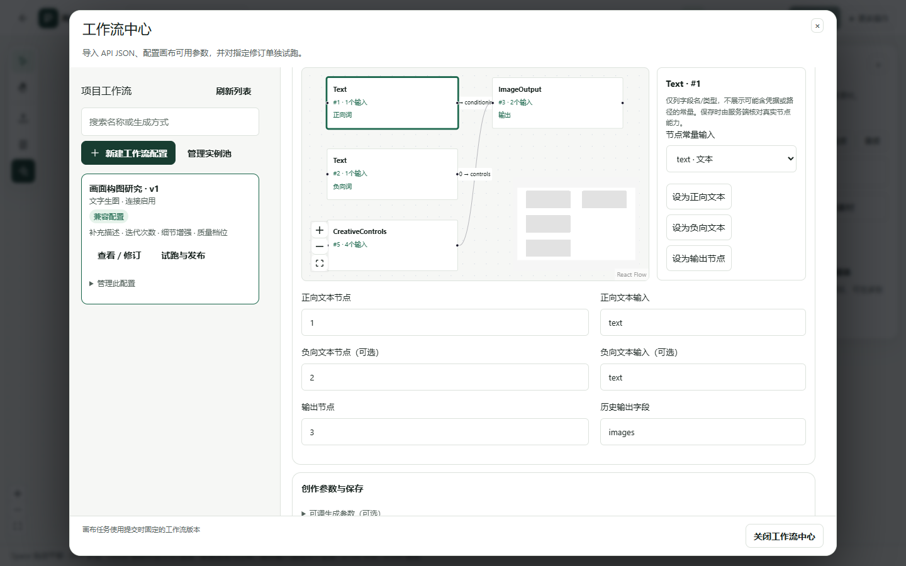
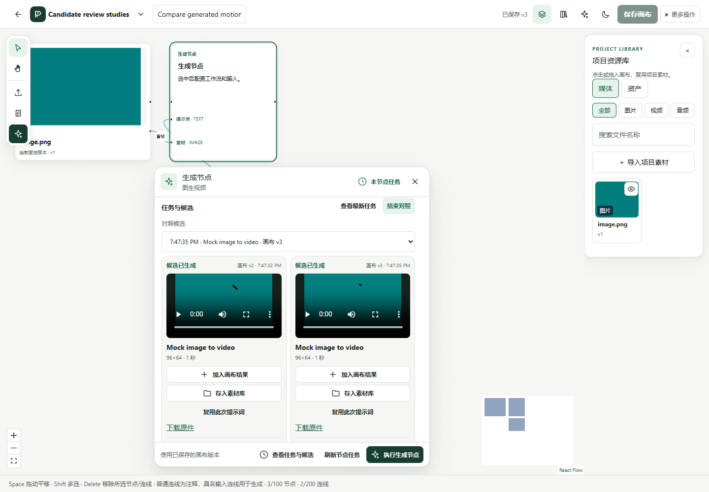

# 正式界面评审包

2026-11-06，分支 `redesign/studio-ui-v2`。这里展示连接正式 Web/API 的实际界面；冻结的设计原型不参与验收。测试使用独立数据库和测试账户，图片来自仓库原创 SVG，视频为合成短片，生成服务为本地 Mock ComfyUI。不能将这些画面理解为真实模型画质或 R2V 已验收。

## 关键页面

项目直接进入上次画布；系统自动生成标识。单工作区隐藏选择器，无封面项目显示占位。



正式画布是项目主视图。资源库、提示词与生成就地使用，保存、固定版本、冲突和任务恢复沿用原实现。下图素材确实经过上传、FFprobe、归档、工作流提交、Mock 返回及候选入库，插画和短片仅为测试内容。



提示词库支持搜索、固定修订、完整正负词及历史；节点内另有轻量选择器。工作流中心管理 API JSON、映射、创作参数与修订，普通创作不展示完整技术图。





候选可切换历史和双结果对照，分别入库、加入画布或复用提示词。观察历史时新任务不会自动切换当前结果；此处没有剪辑轨道或自动选片。



资源预览不添加节点。授权读者可预览/下载，修改按钮由服务端权限与现有固定引用规则约束。手机端可切换管理列表与详情，画布资源库按需展开。

[只读手机预览](resource-mobile.png) · [手机项目首页](project-mobile.png) · [素材上传](media.png) · [工作流实际 150% 缩放](workflow-zoom.png)

## 验收矩阵

| 领域 | 自动化及真实页面证据 | 边界 |
|---|---|---|
| 项目、提示词管理、工作流中心 | 1920×1080、1440×900、1366×768、390×844，各深浅主题；键盘/鼠标、草稿编辑与控件可达性 | 正式 API 与独立测试数据 |
| 实际浏览器缩放 | 上述三个页面，以及画布、提示词就地应用、资源预览和候选对照，分别检查 125%/150% | 固定 1440×900 浏览器，调用并读回 tabs 缩放倍率，核对 innerWidth/devicePixelRatio；不是 CSS zoom 或缩小视口 |
| 画布完整闭环 | 创建项目/多画布、上传、拖入、提示词、工作流导入/映射、单首帧执行、结果、入库、第二画布复用、刷新恢复 | FFmpeg/FFprobe 和生产持久化实现真实，模型使用 Mock |
| 冲突 | [画布保留草稿](conflict.png)、[提示词保留草稿](prompt-conflict.png) | 拒绝过期写入，不静默覆盖 |
| 异常 | [无效工作流](workflow-error.png)、[上传失败恢复](upload-error.png) | 失败保留输入，允许重试 |
| 权限 | [项目撤权](denied.png)、[只读预览](resource-mobile.png) | 服务端授权、跨项目隔离、私有声音及撤权回归 |
| 任务 | [生成中](running.png)、[结果归档](canvas.png)、[双候选](candidates.png) | 已提交任务关闭页面后继续运行；结果不自动成为输入 |

更完整的尺寸/主题截图保留于忽略的 `test-results/`，CI 提供 `studio-ui-evidence` artifact。此包仅收录 15 张代表图，文件尺寸与来源见 [captures.json](captures.json)，不包含运行数据库、浏览器 profile、凭据或第三方闭源资源。

## 范围与后续

已经接入项目、多画布、媒体导入/预览、固定引用、提示词库、工作流中心、单节点生成、候选对照和显式入库。原 NestJS/React/React Flow/Drizzle/SQLite、Generation Worker、Provider、Storage、RBAC 与不可变历史继续复用。源码职责见[工程地图](../../architecture/REPOSITORY-MAP.md)，实际测试数字和排期只见[实施状态](../../IMPLEMENTATION-STATUS.md)。

当前为单节点、单首帧、单产物。多图片/视频/音频输入、多输出、指定项目/用户共享、任选素材包、S3、真实多机与正式 LAN/TLS 部署仍未交付。早期官方 I2V 的实机证据不代替本轮新链路或多参考模型验收。最终视觉认可、合并 main 仍待用户授权，草稿 PR 不代表已获认可。

## 运行与复现

日常启动和升级见[运行手册](../../operations/DEVELOPMENT.md)。首次依赖安装/配置后，API、Web、Generation Worker 分别启动；本分支未新增数据库迁移。构建升级需重启对应服务，不能只更新静态页面。

在仓库根依次运行（后两套共用端口，不能同时运行）：

```powershell
npm run build
npx playwright test --config playwright.boards.config.ts
npx playwright test --config playwright.workflows.config.ts
npm run review:ui
```

`review:ui` 只从明确列出的正式页面 PNG 收集代表图，缺失任何一张即失败；不启动参考项目、访问用户作品或调用真实 GPU。每轮验收后可重复生成本目录截图和来源清单。CI 的 PNG 与错误摘要上传范围同样有界，不收集测试 profile 或数据库。
