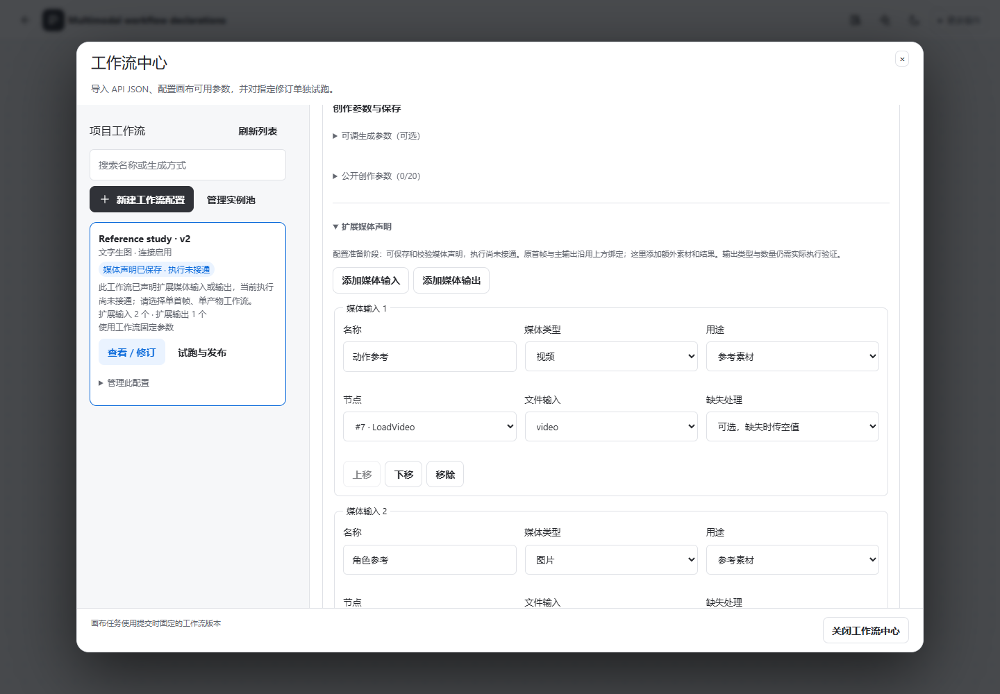

# 扩展媒体声明评审 · L3-B1

2026-11-06，分支 `feature/workflow-media-contract`，叠加原 UI PR #1，不合并 main。使用正式 Web/API、独立测试数据库和 Mock 节点元数据，无真实 GPU 或用户作品。

工作流中心可为原首帧之外的图片/视频/音频定义名称、用途、绑定和缺失规则；可声明额外的预览/中间输出并调整顺序。UUID 自动生成，保存追加不可变版本。原主输出、正负词、单首帧与标量参数继续复用。

[深色桌面](dark.png) · [手机配置](mobile.png)

**声明可保存，扩展执行尚未接通。** 远端上传类型和 output_node 校验不等于模型或真实输出已经验收。所有生成入口同时在前端禁用、服务端拒绝；不会静默忽略额外素材、回退原图中的本机文件或消耗真实 GPU。原单首帧、单产物工作流不受影响。

本地 API 241、工作流 13、画布 21、主入口 1、图解析 4，以及构建/类型/格式通过。新场景验证输入/输出配置、排序/删除、失败保留、固定修订读回、只读摘要去技术信息，以及项目/画布/试跑不入队。四档尺寸、深浅主题和实际缩放沿用正式套件；本页三图为新配置的浅深桌面及390px手机代表状态。

下一步 B2 扩展固定媒体快照、Provider 上传/注入和 Worker 恢复，随后 B3 接画布槽位与排序。真实 R2V 等模型验收独立进行。跨项目共享仍默认拒绝，不通过本包绕过授权。

复现：构建后运行 `node --test apps/api/test/workflow-media.test.mjs` 和 `npx playwright test --config playwright.workflows.config.ts --grep "media declarations edit"`。截图分别来自 `test-results/workflow-media-desktop.png`、`workflow-media-dark.png` 和 `workflow-media-mobile.png`，不收集 DB、profile 或运行凭据。详细范围见[合同](../../modules/WORKFLOW-MEDIA-CONTRACT-B1.md)，当前结果见[实施状态](../../IMPLEMENTATION-STATUS.md)。
